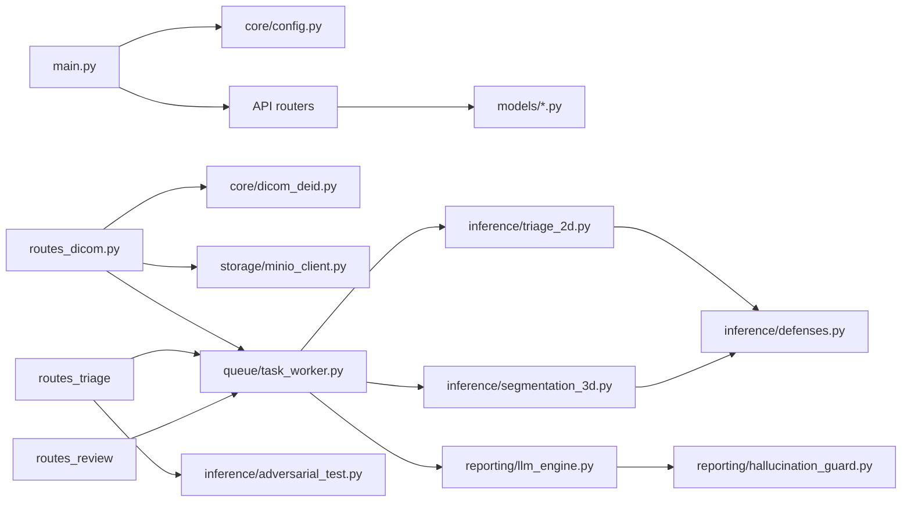

# Current-State Architecture — ClinAI / MedVis (Phase 00)

This document describes what the repository actually runs at revision
`9294389` plus the pre-existing uncommitted web worktree edits observed during
the Phase 00 audit. It is intentionally a **current-state** record, not a
target architecture and not a regulatory or clinical approval statement.

## 1. System boundary

The repository is a Python FastAPI application with a static HTML/JavaScript
client. It can run as one Uvicorn process on a developer workstation. By
default it uses local filesystem directories, an in-memory registry restored
from JSON, FastAPI background callbacks, torchvision/MONAI model objects, and a
deterministic reporting template. MinIO, Redis/Celery, and a Hugging Face
report model are optional code paths, not the default deployment.

```mermaid
flowchart TB
  subgraph Client[Browser client]
    UI[web/index.html]
    JS[web/app.js]
    CSS[web/styles.css]
    UI --> JS
    UI --> CSS
  end

  subgraph API[Single FastAPI/Uvicorn process]
    Main[backend/app/main.py]
    Ingest[routes_dicom.py]
    DicomWeb[routes_dicomweb.py]
    Triage[routes_triage.py]
    Review[routes_review.py]
    Health[/api/v1/health]
    Main --> Ingest
    Main --> DicomWeb
    Main --> Triage
    Main --> Review
    Main --> Health
  end

  subgraph Processing[In-process processing]
    Deid[core/dicom_deid.py]
    Worker[queue/task_worker.py]
    ResNet[inference/triage_2d.py]
    Swin[inference/segmentation_3d.py]
    Guard[reporting/hallucination_guard.py]
    Report[reporting/llm_engine.py]
    Defense[inference/defenses.py]
    Worker --> ResNet
    Worker --> Swin
    Worker --> Report
    Report --> Guard
    ResNet --> Defense
    Swin --> Defense
  end

  subgraph Stores[Local state and optional services]
    Raw[data/dicom_raw]
    Clean[data/dicom_clean]
    Object[data/storage/medical-imaging-studies]
    Registry[data/analysis_results.json]
    Audit[data/gmlp_audit_trail.jsonl]
    Empty[models_weights/.gitkeep]
    MinIO[(Optional MinIO/S3)]
    Redis[(Optional Redis/Celery)]
  end

  JS -->|HTTP fetch| Main
  Ingest --> Raw
  Ingest --> Deid
  Deid --> Clean
  Ingest --> Object
  Ingest --> Worker
  Worker --> Registry
  Review --> Audit
  DicomWeb --> Clean
  Object -. fallback/optional .-> MinIO
  Worker -. optional queue .-> Redis
  ResNet -. no repo task artifact .-> Empty
  Swin -. no repo checkpoint .-> Empty
```

## 2. Component inventory

| Component | Location | Responsibility in the current system | State |
|---|---|---|---|
| Application bootstrap | `backend/app/main.py` | Creates FastAPI app, permissive CORS, routers, health, and static mount. | Executable; no security middleware. |
| Configuration | `backend/app/core/config.py` | Settings, filesystem paths, device/model flags, optional services. | Executable; unsafe defaults and permissive `extra="allow"`. |
| DICOM de-identification | `backend/app/core/dicom_deid.py` | Replaces selected patient values, removes selected tags/private tags, adds de-identification tags. | Executable but incomplete release boundary. |
| Multipart/C-STORE/demo routes | `backend/app/api/v1/routes_dicom.py` | Upload, simulated local C-STORE trigger, synthetic demo generation. | Executable; unauthenticated and unsafe upload path. |
| DICOMweb convenience routes | `backend/app/api/v1/routes_dicomweb.py` | Study listing and PNG slice/frame rendering. | Executable subset; not demonstrated QIDO-RS/WADO-RS conformance. |
| Triage/worklist routes | `backend/app/api/v1/routes_triage.py` | Registry listing, study lookup, adversarial evaluation. | Executable; no resource checks. |
| Review/audit routes | `backend/app/api/v1/routes_review.py` | Levenshtein metric, JSONL append, status update, audit reads. | Executable; identity and integrity are client-controlled. |
| Study worker | `backend/app/queue/task_worker.py` | Loads files, chooses 2D/3D path, calls models/reporting, persists registry. | In-process callback by default; no durable state machine. |
| 2D inference | `backend/app/inference/triage_2d.py` | Preprocesses image, runs ResNet, calculates thresholds/boxes. | Architecture executes; task head is unverified. |
| 3D inference | `backend/app/inference/segmentation_3d.py` | Resamples volume, runs SwinUNETR, calculates organ volumes. | Architecture executes; checkpoint absent and fallback fabricates volume. |
| Reporting | `backend/app/reporting/llm_engine.py` | Template report, seeded token entropy, heuristic guard. | Not actual multimodal LLM grounding. |
| Object storage | `backend/app/storage/minio_client.py` | Local filesystem object semantics or optional MinIO. | Local mode default; no retention/encryption policy. |
| Models/schemas | `backend/app/models/*.py` | Pydantic request/result structures, including FHIR-like schemas. | Runtime validation exists; contracts lack provenance/security state. |
| Browser workspace | `web/index.html`, `web/app.js`, `web/styles.css` | Worklist, canvas, report/review/security tabs, upload. | Effective working tree has restrained UI edits; functional safety gaps remain. |
| Demo generator | `scripts/generate_demo_data.py` | Creates synthetic CR/CT DICOM phantoms with identifiable test values. | Useful fixture generator; not clinical data. |
| Startup/model scripts | `run.sh`, `scripts/run_system.py`, `scripts/download_models.py` | Launch service, select an available port, print model status/download optional LLM. | Startup executes; model inspection overstates readiness. |

## 3. Runtime sequence

```mermaid
sequenceDiagram
  participant B as Browser
  participant A as FastAPI
  participant D as Deidentifier
  participant F as Filesystem/Storage
  participant W as BackgroundTasks/Worker
  participant M as Model objects
  participant R as Registry/JSON
  participant L as Review JSONL

  B->>A: POST /api/v1/dicom/upload (multipart)
  A->>F: write raw_dir / filename
  A->>D: pydicom dataset
  D-->>A: modified dataset + pseudonym record
  A->>F: write clean DICOM + object copy
  A->>W: schedule process_study_async
  A-->>B: success + generated task_id
  W->>F: read all supplied DICOM files
  W->>M: 2D triage; optional 3D segmentation
  W->>M: deterministic report/heuristic audit
  W->>R: replace in-memory record and JSON file
  B->>A: GET worklist/study/image/report
  A-->>B: unauthenticated registry/PNG/report
  B->>A: POST /api/v1/review/submit
  A->>L: append client-provided actor/decision digest record
  A->>R: set status REVIEWED
  A-->>B: audit record
```

## 4. Storage and ownership map

| Path/service | Contents | Authority today | Retention/deletion behavior |
|---|---|---|---|
| `data/dicom_raw/<batch>` | Temporary raw upload bytes | Not registered | `shutil.rmtree` on normal/exception path, but traversal/escaped files and process crashes are not handled. |
| `data/dicom_clean/<study>` | Sanitized DICOM files used by worker/viewer | Filesystem | No policy; tracked fixtures and generated runtime data can coexist. |
| `data/storage/<bucket>/studies/<study>` | Copy of sanitized DICOM object | Local object-store fallback | No retention, encryption, versioning, delete API, or integrity manifest. |
| `data/analysis_results.json` | Serialized `StudyAnalysisResult` map | Authoritative operational registry | Whole-file rewrite; no transaction/locking/concurrent-worker protocol. |
| `data/gmlp_audit_trail.jsonl` | Review records | Audit source | Append-only by convention only; no keyed signature or immutable storage. |
| `models_weights/` | Intended local model artifacts | Empty in repository | No registry, digest, download/verification, retention, or rollback metadata. |
| Optional MinIO | Same object names as local store | Disabled (`USE_LOCAL_STORAGE=True`) | Connection failure silently falls back to local. |
| Optional Redis/Celery | Intended task broker | Disabled (`USE_CELERY=False`) | No deployment, retry, visibility timeout, or dead-letter contract. |

## 5. Interface and state model

### 5.1 Internal call graph



### 5.2 Current status values

`StudyAnalysisResult.status` permits only `PENDING_TRIAGE`, `TRIAGED`,
`PENDING_REVIEW`, and `REVIEWED` (`backend/app/models/triage_schemas.py:52-67`).
The worker writes `TRIAGED` even when the model artifact is missing; the review
route writes `REVIEWED` for all three decisions. There is no representation of
`RECEIVED`, `VALIDATING`, `QUARANTINED`, `READY`, `PROCESSING`, `FAILED`, or
`CANCELLED`, and no legal transition enforcement.

The desired Phase 02 state machine therefore cannot be inferred from the
current enum; it must be designed and migrated explicitly.

## 6. Current API surface

| Route group | Paths | Payload/return shape | Backing data |
|---|---|---|---|
| DICOM ingest | `POST /api/v1/dicom/upload`, `POST /api/v1/dicom/c-store`, `POST /api/v1/dicom/seed-demo` | Multipart/form fields or no body; upload returns `DICOMUploadResponse`; others return untyped JSON. | Local raw/clean paths, object store, worker callback. |
| DICOMweb-like | `GET /dicomweb/studies`, `GET /dicomweb/studies/{study_uid}/instances/{instance_uid}/frames/{frame_id}`, `GET /dicomweb/studies/{study_uid}/slice/{slice_index}` | JSON study list or rendered `image/png`. | `data/dicom_clean`. |
| Triage | `GET /api/v1/triage/worklist`, `GET /api/v1/triage/studies/{study_uid}`, `POST /api/v1/triage/studies/{study_uid}/adversarial-eval` | Untyped worklist/metrics, `StudyAnalysisResult`, untyped metrics. | In-memory registry/JSON and clean DICOM. |
| Review | `POST /api/v1/review/submit`, `GET /api/v1/review/audit/{study_uid}` | `RadiologistReviewSubmission` to `GMLPAuditRecord`; JSONL array read. | Registry and audit JSONL. |
| System/static | `GET /api/v1/health`, `/`, `/static/*`, `/docs`, `/redoc`, `/openapi.json` | Health metadata, static files, OpenAPI UI/spec. | Runtime and `web/`. |

There is no explicit version negotiation beyond `/api/v1`, no error envelope,
pagination, idempotency header, correlation ID, conditional retrieval,
content negotiation, or security scheme in the generated OpenAPI contract.

## 7. Data transformations and imaging assumptions

### DICOM ingress

1. The upload endpoint trusts a multipart filename for the first raw path.
2. pydicom reads each file; parse exceptions are swallowed and the loop
   continues.
3. The first observed study UID controls the clean directory, but subsequent
   files are not rejected if they belong to a different study/series.
4. The SOP UID becomes the clean filename; it is not validated as a safe path
   component.
5. The de-identifier preserves many acquisition tags but does not establish a
   complete profile or quarantine decision.

### 2D preprocessing

`triage_2d.py:51-72` min/max-normalizes raw pixels, resizes to 224×224,
repeats one channel three times, then quantizes and smooths. It does not apply
modality-specific rescale/VOI rules before inference. The classifier applies
independent sigmoid values to a fresh multi-label task head.

### 3D preprocessing and measurement

`task_worker.py:73-97` stacks slices after a `SliceLocation`/`InstanceNumber`
sort and sends a 64³ resampled volume to SwinUNETR. `segmentation_3d.py:88-103`
uses only first two PixelSpacing values and one SliceThickness, applies a voxel
scale and a simple dimension ratio, and never exposes a voxel-to-patient
transform or predicted mask. It does not prove that the source stack is
regular, geometrically coherent, or from one series.

### Rendering

`routes_dicomweb.py:13-49` applies a linear window and MONOCHROME1 inversion,
then returns PNG. Frame IDs are not used to select multiframe data. The slice
route sorts names, clamps out-of-range indices, and reads that file
(`routes_dicomweb.py:96-112`).

## 8. Operational and security posture summary

| Control area | Current posture | Phase 00 disposition |
|---|---|---|
| Identity/authentication | None in API or UI | P0 blocker |
| Authorization/tenancy | UID membership only; no organization/user model | P0 blocker |
| Upload safety | Raw filename, whole-body read, no limits/quarantine | P0/P1 blocker |
| De-identification | Selected top-level tags/private tags | P0 blocker until profile and tests exist |
| Model provenance | Empty local model directory; default/random runtime | P0 blocker |
| Report grounding | Threshold/template/heuristic; no evidence graph | P0/P1 blocker |
| Audit integrity | Plain SHA-256 over client fields and JSONL append | P1 blocker |
| Network exposure | Wildcard CORS, docs enabled, no TLS boundary | P0/P1 blocker |
| Persistence | JSON registry and local duplicate object copies | P1 blocker for multi-user operation |
| Queue/recovery | FastAPI background task by default | P1 blocker for durable workflow |
| Observability | `print`, raw exception responses, no correlation IDs | P1/P2 gap |
| Testing | Four unit-ish scripts; no API/security/E2E/interoperability | P2 gap |
| Supply chain | Open-ended requirements, no lock/SBOM/scanners | P2 gap |

## 9. Architecture decision record for the next phase

The current architecture should be treated as a **research/demo prototype
boundary**. The first implementation phase must not add more clinical features
on top of the current inference path. The safe sequence is:

1. Establish fail-closed output semantics and explicit demo labeling.
2. Establish identity, roles, resource authorization, and safe upload/quarantine
   boundaries.
3. Replace JSON/file authority with transactional persistence and a durable job
   lifecycle.
4. Correct DICOM geometry/pixel handling and define supported modalities.
5. Add one validated, versioned, narrowly scoped model pathway.
6. Ground structured reports in typed evidence, then rebuild the viewer/worklist
   around truthful states.

This ordering preserves FastAPI and the existing demo routes as compatibility
surfaces where possible without implying that their current security or
clinical semantics are acceptable.

## 10. Source-to-architecture reference map

| Concern | Primary source files |
|---|---|
| Bootstrap/config | `backend/app/main.py`, `backend/app/core/config.py` |
| Upload/de-id | `backend/app/api/v1/routes_dicom.py`, `backend/app/core/dicom_deid.py` |
| Retrieval/render | `backend/app/api/v1/routes_dicomweb.py` |
| Worklist/review | `backend/app/api/v1/routes_triage.py`, `backend/app/api/v1/routes_review.py` |
| Persistence/queue | `backend/app/queue/task_worker.py`, `backend/app/storage/minio_client.py` |
| Models/outputs | `backend/app/inference/triage_2d.py`, `segmentation_3d.py`, `defenses.py`, `adversarial_test.py` |
| Reporting | `backend/app/reporting/llm_engine.py`, `hallucination_guard.py` |
| Contracts | `backend/app/models/dicom_schemas.py`, `fhir_schemas.py`, `gmlp_schemas.py`, `triage_schemas.py` |
| Execution | `run.sh`, `scripts/run_system.py`, `scripts/download_models.py`, `scripts/generate_demo_data.py` |
| UI | `web/index.html`, `web/app.js`, `web/styles.css`; current untracked `web/privacy.html`, `web/terms.html` |
| Evidence/fixtures | `data/analysis_results.json`, `data/gmlp_audit_trail.jsonl`, tracked DICOM trees, `tests/*.py` |

## 11. Current-state conclusion

The effective topology is simple enough to evolve without unnecessary
microservices, but its current trust boundaries are unsafe: an anonymous
browser reaches a single process that can read/write local medical-image state,
invoke unsupported models, persist clinical-looking reports, and append audit
records. The architecture diagram is therefore a forensic map, not a design
endorsement. See `docs/audits/PHASE_00_BASELINE.md` for severity findings,
test evidence, acceptance criteria, rollback notes, and the ordered remediation
backlog.
