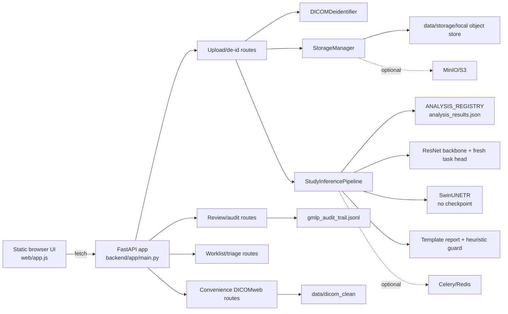

# Phase 00 Baseline — ClinAI / MedVis Forensic Audit

**Audit decision:** **FAIL** for the requested safety/security exit gate.  The
repository has a reproducible demo baseline, but it must not be treated as a
clinical, privacy-preserving, or production-ready system.  The highest-impact
reason is that executable inference paths expose outputs from an unverified
random task head and an uninitialized SwinUNETR as clinical findings.

**Audit date:** 2026-10-14 (Asia/Calcutta)<br>
**Repository:** `https://github.com/Rehaa02/MedVis`<br>
**Audited workspace:** `/Users/yogendharkusumanchi/CNN`<br>
**Base revision:** `9294389` (`Initial commit: ClinAI PACS - AI-Based Medical Image Diagnosis & Triage Orchestrator`)<br>
**Branch:** `main`<br>
**Scope:** Phase 00 forensic audit only. No production code, model code, data,
or user-owned frontend edits were silently fixed.

## 1. Scope, evidence, and limitations

### 1.1 Evidence reviewed

`git ls-files` reported **166 tracked files**:

| Area | Tracked files | Coverage |
|---|---:|---|
| `backend/` | 19 | FastAPI app, routes, schemas, inference, reporting, queue, storage |
| `scripts/` | 3 | startup, model inspection/download, synthetic-data generation |
| `tests/` | 4 | de-identification, defenses, reporting/audit, triage/segmentation |
| `web/` | 3 | `app.js`, `index.html`, `styles.css` |
| `data/` | 131 | DICOM fixtures, clean/storage copies, registry, audit JSONL |
| `models_weights/` | 1 | `.gitkeep` only; no checkpoint artifact |
| Root files | 5 | README, literature survey, requirements, launcher, gitignore |

All 26 tracked Python files, the tracked JavaScript/HTML/CSS files, shell
launcher, dependency manifest, JSON/JSONL records, README, literature report,
and representative tracked DICOM files were inspected. DICOM files were parsed
read-only with pydicom to inventory modalities, transfer syntax, PHI-bearing
tags, and study counts.

### 1.2 Working-tree caveat

The starting workspace was not clean:

```text
 M web/app.js
 M web/index.html
 M web/styles.css
?? web/privacy.html
?? web/terms.html
```

The three tracked web files contain uncommitted UI changes and the two policy
pages are untracked.  They were inspected and preserved.  Findings in this
document describe the effective working tree where relevant and identify the
base revision when a distinction matters.  The audit artifacts themselves are
new files and are not evidence that the existing implementation was changed.

### 1.3 What was not verified

No clinical performance, external validation, regulatory conformity, DICOM
conformance, security certification, or privacy compliance is inferred.  The
available repository contains no task-trained ResNet checkpoint, SwinUNETR
checkpoint, model card, dataset lineage, locked test set, database migration,
container, CI workflow, or authentication configuration.  Missing runtime
dependencies or services are recorded as **unverified**, not assumed to work.

## 2. Executive decision and exit-gate evidence

| Gate | Result | Evidence |
|---|---|---|
| Install reproducibility | **PASS (environment-local)** | `python3 -m pip install -r requirements.txt` completed with all requirements already satisfied. The file uses open-ended `>=` ranges and has no lock file, so this is not a deterministic clean-room install. |
| Python syntax | **PASS** | `python3 -m compileall -q backend scripts tests` exited 0. |
| Unit/test scripts | **PASS with warnings** | `python3 -m pytest -q`: 4 passed, 4 warnings. Direct README commands also exited 0. Tests exercise shapes and heuristics, not clinical correctness or access control. |
| Frontend syntax | **PASS** | `node --check web/app.js` exited 0. No frontend integration or end-to-end suite exists. |
| Optional static analysis | **UNVERIFIED** | `ruff`, `mypy`, and `bandit` were unavailable; no repository configuration or CI gate installs them. |
| Application startup | **PASS (local demo)** | Uvicorn started on `127.0.0.1:8765`; `/api/v1/health`, worklist, and DICOMweb study listing returned successfully. |
| Unauthenticated data exposure | **FAIL** | Without credentials, the worklist, study analysis, audit history, DICOMweb listing, and Swagger docs all returned HTTP 200. |
| Verified clinical inference | **FAIL** | `models_weights/` contains only `.gitkeep`; ResNet replaces its classifier with a fresh 11-class linear layer and SwinUNETR has no checkpoint load. |
| Phase 00 safety/security exit gate | **FAIL** | P0 findings below are blockers. Passing demo tests do not offset unsupported clinical assertions, unauthenticated access, or unsafe upload/de-identification paths. |

### 2.1 Reproduction environment

Observed on the audit host:

```text
Python 3.14.7
torch 2.13.0
torchvision 0.28.0
monai 1.6.0
pydicom 3.0.2
fastapi 0.141.1
pydantic 2.13.5
uvicorn 0.30.6
```

The pytest run emitted a Pydantic class-based-config deprecation warning, two
TorchScript deprecation warnings, and an MPS padding fallback warning.  These
are recorded rather than treated as failures.

## 3. Actual executable features versus README claims

### 3.1 Features that execute in the current repository

1. A single FastAPI/Uvicorn process serves a static browser UI and 12 OpenAPI
   paths.  Route registration is in `backend/app/main.py:42-46` and the
   generated OpenAPI inventory is listed in Section 7.
2. Multipart files are read into a temporary directory, parsed with pydicom,
   partially de-identified, written to `data/dicom_clean`, and copied into the
   configured local object-store directory by
   `backend/app/api/v1/routes_dicom.py:18-107` and
   `backend/app/storage/minio_client.py:15-62`.
3. The default asynchronous mechanism is FastAPI `BackgroundTasks`, not a
   durable queue.  The optional Celery definition is conditional on
   `USE_CELERY`, which defaults to false (`backend/app/core/config.py:28-30`,
   `backend/app/queue/task_worker.py:143-156`).
4. An in-memory `ANALYSIS_REGISTRY` is loaded from and rewritten to one JSON
   file (`backend/app/queue/task_worker.py:18-38`).
5. A local demo workflow can generate synthetic CR and CT DICOM files and run
   the same pipeline (`scripts/generate_demo_data.py:83-228`,
   `backend/app/api/v1/routes_dicom.py:135-182`).
6. Basic image-to-PNG rendering, worklist sorting, report-template rendering,
   a Levenshtein edit metric, and append-only JSONL writes execute.

### 3.2 Claims that are README/report-only or materially overstated

| Claim | Forensic result |
|---|---|
| Asynchronous DICOM C-STORE gateway | `/api/v1/dicom/c-store` accepts form fields and scans an existing local directory. It is explicitly named `simulate_c_store_push` (`routes_dicom.py:109-133`); there is no DIMSE listener or C-STORE association. |
| ResNet clinical triage / NIH14 weights | The code downloads/uses torchvision ImageNet `DEFAULT` backbone weights, then replaces `fc` with an untrained 11-class layer (`triage_2d.py:38-49`). No NIH14/CheXpert task artifact is loaded. |
| MONAI BTCV multi-organ segmentation | `SwinUNETR` is instantiated without `load_state_dict` or a checkpoint path (`segmentation_3d.py:37-46`). The advertised model is therefore not verified. |
| Multimodal clinical LLM | Default configuration disables HF loading and calls an internal deterministic template engine (`config.py:41-43`, `llm_engine.py:17-38,57-128`). Even when HF loading is enabled, the loaded model is not used by `generate_draft_report`. |
| ReXTrust/RadFlag/DEAR evidence guard | Entropies are seeded pseudo-random numbers assigned from token strings (`llm_engine.py:130-159`); RadFlag is a single phrase contradiction check and DEAR checks a small hard-coded mismatch list (`hallucination_guard.py:55-69,87-98`). |
| Lesion localization and segmentation overlays | Backend bounding boxes use fixed coordinates by pathology (`triage_2d.py:131-161`). Frontend organ masks are four fixed ellipses, not returned masks or model geometry (`web/app.js:361-395`). |
| FDA/GMLP/21 CFR compliance | The code labels itself compliant in API/UI/report strings, but has no identity, authorization, signature key management, immutable log, validation evidence, or regulatory quality system (`main.py:26-30,65-69`, `routes_review.py:33-84`). This audit makes no compliance claim. |
| DICOMweb QIDO-RS/WADO-RS | The implementation is a convenience subset: one study listing and rendered PNG endpoints. It does not provide standard query parameters, series/instance metadata routes, multipart DICOM retrieval, negotiation, or conformance evidence (`routes_dicomweb.py:51-112`). |
| HL7 FHIR ImagingStudy integration | `FHIRImagingStudy` is a Pydantic schema only; there is no FHIR route, serialization endpoint, validation profile, or outbound integration (`models/fhir_schemas.py:35-55`). |
| Sub-30-second clinical performance | The tests assert only `<10s` on random input (`tests/test_monai_segmentation_triage.py:5-26`); repository literature reports are not reproducible benchmarks (`LITERATURE_SURVEY.md:219-255`). |

## 4. End-to-end data and workflow trace

### 4.1 Executable path

```text
Browser multipart upload
        |
        v
FastAPI /api/v1/dicom/upload
        |
        +--> data/dicom_raw/<uuid>/<filename>       (unbounded raw bytes)
        |
        +--> pydicom parse -- failures silently skipped
        |
        +--> DICOMDeidentifier (top-level edits/private-tag removal)
        |
        +--> data/dicom_clean/<StudyUID>/<SOPUID>.dcm
        |       +--> local storage/<bucket>/studies/<StudyUID>/<SOPUID>.dcm
        |
        +--> FastAPI BackgroundTasks
                |
                v
        StudyInferencePipeline
          +--> all supplied datasets; modality from first dataset
          +--> mid-slice 2D ResNet path
          +--> multi-file 3D SwinUNETR path
          +--> deterministic report template + heuristic audit
          +--> ANALYSIS_REGISTRY[StudyUID]
                    +--> data/analysis_results.json
                    +--> /triage/worklist and /triage/studies/{uid}
                    +--> browser review editor
                               +--> data/gmlp_audit_trail.jsonl
                               +--> status REVIEWED
```

### 4.2 Lifecycle mapping

| Concern | Current implementation | Gap / risk |
|---|---|---|
| Ingestion | Multipart upload and a simulated C-STORE trigger. | No authenticated sender, no study/series transaction, no size/file-count quotas, no quarantine state, no durable job ID. |
| Pseudonymization | Fixed/reproducible SHA-256 strings; selected top-level tag deletion; private-tag removal. | Salt is hard-coded; UID remapping, nested sequences, free text, overlays, pixel annotations, malformed/uncertain cases are not addressed. |
| Storage | Local filesystem is the default; optional MinIO; clean files and storage copies are both retained. | No private bucket policy, encryption/retention/deletion, object integrity/versioning, DB metadata, or cleanup guarantees. |
| Inference | Task worker decides 2D/3D from file count/pixel dimensionality, runs unverified models, writes results. | No model registry/provenance, validation gate, idempotency, cancellation, retry/dead-letter, resource limits, or safe unavailable state. |
| Reporting | Template strings convert thresholds into Findings/Impression and recommended actions. | Unsupported normal/diagnostic claims, no evidence references, no source-to-claim links, no clinician-authored distinction, no release gate. |
| Worklist | In-memory/JSON records sorted by urgency. | No patient/organization/study authorization, priority audit, real processing states, pagination, concurrency safety, or persistence transaction. |
| Human review | Client supplies radiologist ID and final text; endpoint appends JSONL and sets status. | No authentication/role/resource authorization, signature key, review state machine, rejection semantics, version history, or immutable store. |
| Image retrieval | Files selected by directory and filename; PNG rendering with simple window mapping. | No series isolation, geometry-aware ordering, standard WADO negotiation, DICOM byte retrieval, frame validation, or pixel safety checks. |

## 5. Findings by severity

Severity definitions used here:

* **P0** — unacceptable patient-safety, privacy, or security blocker; stop any
  clinical or exposed deployment.
* **P1** — high-risk correctness or control failure; blocks a production-like
  evaluation until mitigated.
* **P2** — important engineering, interoperability, test, or governance gap.
* **P3** — lower-risk maintainability, documentation, or polish issue.

### P0 — blockers

#### P0-01 — Unsupported model outputs are executable clinical assertions

**Trigger:** importing the application constructs a ResNet model using
`ResNet*_Weights.DEFAULT`, replaces the task head with a newly allocated
`nn.Linear`, and calls `eval()` without loading a task checkpoint
(`backend/app/inference/triage_2d.py:38-49`). The segmentation path constructs
SwinUNETR and also has no checkpoint load (`backend/app/inference/segmentation_3d.py:37-46`).
`models_weights/.gitkeep` is the only tracked entry in the model directory.

**Consequence:** random/unverified logits are converted into probabilities,
urgency tiers, recommended actions, bounding boxes, organ volumes, and reports.
The worker persists and exposes those values as `TRIAGED`/`REVIEWED`
(`backend/app/queue/task_worker.py:80-140`). This can generate false positive
or false negative emergency assertions and is a direct patient-safety blocker.

**Evidence:** runtime inspection found the ImageNet default ResNet metadata has
1,000 categories, while the replacement head has 11 outputs; no repository
checkpoint exists. The persisted registry records model names such as
`PyTorch-ResNet50-NIH14-v1.0.0` and `MONAI-SwinUNETR-BTCV14-v1.0.0` despite no
corresponding verified task artifact (`data/analysis_results.json:597-603`).

**Minimum correction:** fail closed with structured `UNVALIDATED` or
`UNAVAILABLE` output unless a task-compatible, digest-verified artifact passes
load-time compatibility checks. Do not silently substitute random weights.

#### P0-02 — All imaging, analysis, audit, and write routes are unauthenticated

**Trigger:** no route declares an authentication dependency. The public routes
include upload, simulated C-STORE, demo seeding, worklist, study analysis,
adversarial execution, review submission, audit reads, and DICOMweb reads
(`backend/app/api/v1/routes_dicom.py:18-182`,
`backend/app/api/v1/routes_triage.py:14-97`,
`backend/app/api/v1/routes_review.py:33-100`,
`backend/app/api/v1/routes_dicomweb.py:51-112`). CORS is `allow_origins=["*"]`
with credentials, all methods, and all headers (`backend/app/main.py:33-40`).

**Consequence:** an anonymous caller can enumerate pseudonymized studies,
retrieve image renders and analysis/report text, submit a review under any
client-supplied identity, seed expensive work, and run compute-heavy
adversarial evaluation. Pseudonymization is not authorization.

**Runtime evidence:** without an `Authorization` header, the local smoke test
returned HTTP 200 for `/api/v1/triage/worklist`, a known
`/api/v1/triage/studies/{uid}`, `/api/v1/review/audit/{uid}`,
`/dicomweb/studies`, and `/docs`. A nonexistent UID returned 404, demonstrating
existence checking but not access control.

**Minimum correction:** require real authentication and server-derived roles,
organization/study resource checks, CSRF/origin strategy for browser writes,
and deny by default. Add negative tests before any non-demo exposure.

#### P0-03 — Synthetic and hard-coded clinical observations are presented as AI findings

**Trigger:** the 2D engine creates fixed bounding-box coordinates based only on
the top pathology label (`backend/app/inference/triage_2d.py:131-161`). The 3D
engine substitutes the midpoint of a reference range when a predicted organ
volume is under 1 cm³ (`backend/app/inference/segmentation_3d.py:100-109`). The
frontend draws fixed liver/spleen/kidney ellipses whenever any organ volumes
exist (`web/app.js:361-395`).

The reporting engine adds unsupported statements such as normal lungs, normal
heart/aorta, no fracture, or no acute abnormality when the respective anatomy
was not actually evaluated (`backend/app/reporting/llm_engine.py:61-92,94-128`).

**Consequence:** the UI and API can make a fabricated localization, anatomy,
measurement, normal finding, or treatment-oriented recommendation appear
grounded. Existing persisted data shows the effect: a CR record contains
intracranial hemorrhage, pulmonary embolism, and large-vessel-occlusion claims
with a fixed box (`data/analysis_results.json:19-37,89-98`), while a CT record
contains implausible organ volumes and abnormality labels
(`data/analysis_results.json:703-794,800-801`).

**Minimum correction:** remove fabricated overlays/volumes and automatic normal
conclusions; label all synthetic/demo records; make unknown remain unknown;
only display validated masks/claims with source references.

#### P0-04 — De-identification is not a safe release boundary for real DICOM

**Trigger:** pseudonym salts have code defaults (`dicom_deid.py:37-51`), the
implementation edits a finite list of top-level elements and calls
`remove_private_tags()` (`dicom_deid.py:75-85`), but does not inspect nested
sequences, free-text descriptions, overlays, encapsulated objects, or pixel
burned-in annotations. `PatientAge` is explicitly left unchanged
(`dicom_deid.py:69-73`). No uncertainty/quarantine result exists.

Uploads first persist raw bytes using the browser-supplied filename and only
then parse them (`routes_dicom.py:41-52`). There is no rejection based on
`BurnedInAnnotation`, no pixel redaction, and no raw-retention policy.

**Consequence:** a real study may retain PHI in an unhandled tag, nested item,
free text, or pixels while the API labels it de-identified. The raw temporary
path can survive on error or be placed outside the intended batch directory.

**Evidence:** the tracked synthetic generator intentionally inserts names,
IDs, accession, institution, and referring physician data
(`scripts/generate_demo_data.py:33-40`); tracked clean/storage files still
contain pseudonymized `PatientName`, `PatientID`, `AccessionNumber`,
`StudyDescription`, and `SeriesDescription`. A read-only inventory found
55 clean and 55 storage instances; mixed 51- and 69-character
`DeidentificationMethod` values, with pydicom warning that 69 exceeds the LO
limit. This is an interoperability and privacy finding, not proof that every
synthetic pixel contains PHI.

**Minimum correction:** use a documented, tested de-identification profile;
recursively inspect all elements; handle private/free text/UID relationships,
pixel annotations and overlays; quarantine uncertain cases; use validated
environment secrets; delete raw input deterministically.

### P1 — High-risk production blockers

#### P1-01 — Upload and object paths are traversal/overwrite-prone and unbounded

`raw_dir / file.filename` is used without basename/allowlist enforcement
(`routes_dicom.py:32-47`). Dataset `StudyInstanceUID` and `SOPInstanceUID` are
used in directory/file paths without validation (`routes_dicom.py:54-70`). The
entire upload is read into memory, with no byte, file-count, pixel-dimension,
compression-ratio, decompression, or request-rate limit. Invalid DICOM files
are silently skipped (`routes_dicom.py:48-52`). Local storage reads and writes
whole objects (`storage/minio_client.py:39-77`). These paths permit denial of
service, unsafe retention, and possible writes outside the temporary batch
directory.

#### P1-02 — Persistence and queue semantics cannot guarantee work or isolation

`USE_CELERY` defaults false (`config.py:28-30`); normal upload schedules a
`BackgroundTasks` callback, returns a generated `task_id` that is not stored or
correlated, and reports queue semantics that are not actually enabled
(`routes_dicom.py:84-103`). The registry is an in-memory dictionary with a
whole-file rewrite and no lock/transaction (`task_worker.py:18-38,138-140`).
Concurrent uploads, process restart during a write, duplicate submission,
partial studies, and multi-worker deployments can lose or cross-wire records.
There are no quarantine/validation/processing/failed/cancelled states matching
the requested legal state machine.

#### P1-03 — Imaging geometry and modality handling are unsafe for general DICOM

The worker takes modality and spacing from the first dataset and detects 3D
from file count/pixel dimensionality (`task_worker.py:73-85`). It sorts by
`SliceLocation` or `InstanceNumber`, not by the ImageOrientationPatient and
ImagePositionPatient geometry; it does not split series or phases. The web
viewer sorts filenames (`routes_dicomweb.py:101-110`). Rendering applies a
simple linear rescale/window operation and MONOCHROME1 inversion, but does not
use the DICOM VOI LUT, per-frame transforms, signed pixel safeguards, or
multiframe semantics (`routes_dicomweb.py:13-49`). Unsupported modalities are
not rejected. A WADO-like request for an unknown instance silently falls back
to the first file in the study (`routes_dicomweb.py:82-90`).

#### P1-04 — Review identity and audit integrity are client-controlled

`RadiologistReviewSubmission` supplies a default/client value for
`radiologist_id` (`models/gmlp_schemas.py:5-14`). The endpoint trusts the study
UID and identity, accepts any decision, hashes a concatenated payload with
plain SHA-256, appends to a mutable JSONL file, and sets status to `REVIEWED`
for accepted, modified, or rejected decisions (`routes_review.py:40-84`). The
hash is not a keyed signature and there is no append integrity chain, key
rotation, actor authentication, server timestamp policy, version history, or
resource authorization. The API exposes those audit records without auth
(`routes_review.py:86-100`).

#### P1-05 — Secrets and production security defaults are permissive

MinIO credentials, a disabled queue, local storage, insecure transport, and
default salts are in code (`config.py:20-30,38-43`,
`dicom_deid.py:37-51`). MinIO silently falls back to local storage when the
connection fails (`storage/minio_client.py:21-37`). Exception text is returned
to clients (`routes_dicom.py:105-107`) and the service prints study IDs,
locations, model/device information, and clinical processing state
(`main.py:15-24`, `task_worker.py:58-71,138-140`). No request correlation,
rate limiting, safe error envelope, structured privacy-safe logging, or TLS
boundary is implemented.

#### P1-06 — Report generator can call actions and diagnosis without evidence

Pathology probabilities above a threshold become statements and clinical
actions (`llm_engine.py:52-55,113-128`). Default clinical history and
indication text are supplied by schemas and upload form defaults
(`models/fhir_schemas.py:48-55`, `routes_dicom.py:20-24`). The resulting report
does not carry image/series/instance references, calibration context, quality
state, or clinician-authored provenance. Hallucination checks do not block
release when they fail; the worker stores the draft regardless
(`task_worker.py:105-140`).

### P2 — Important gaps

* **P2-01 — Dependency and build provenance is not reproducible.** All 21
  requirements are lower-bounded, not pinned (`requirements.txt:2-21`); there
  is no lock file, SBOM, Dockerfile/Compose, CI, scan configuration, or model
  digest. `download_models.py --inspect` prints `READY` for models without
  checking local artifacts (`scripts/download_models.py:28-46`).
* **P2-02 — LLM and uncertainty telemetry is synthetic.** `np.random.seed(42)`
  and `np.random.uniform` create token entropies from labels, not model logits
  (`llm_engine.py:130-149`). `ClinicalReportingLLM` advertises BioMistral in
  `generated_by_model` even when configuration names Qwen and HF mode is off
  (`config.py:41-43`, `llm_engine.py:17-38,161-169`).
* **P2-03 — DICOMweb/FHIR contracts are incomplete.** The OpenAPI surface has
  no standard QIDO filters, series/instance metadata, DICOM byte WADO, content
  negotiation, or FHIR route. No conformance fixture or Orthanc interoperability
  test exists.
* **P2-04 — Frontend is not a medical viewer and contains misleading defaults.**
  The canvas supports only image load, slice slider, window presets, invert,
  and hard-coded overlays. Pan, zoom, measurements, geometry-aware MPR,
  comparison, source references, permissions, asynchronous job states, and
  integration tests are absent. The UI labels the workspace with DICOM
  de-identification and model names without a validation state
  (`web/index.html:21-39,92-114`).
* **P2-05 — Test suite does not cover the requested risks.** Tests use random
  tensors, assert output shape/category, and directly invoke internal helpers
  (`tests/test_adversarial_defenses.py:6-30`,
  `tests/test_monai_segmentation_triage.py:5-26`). There are no API,
  authentication, IDOR, traversal, DICOM geometry, malformed-file, concurrency,
  restart, audit-tamper, or frontend workflow tests.
* **P2-06 — Tracked operational/clinical-looking data is mixed with source.**
  `data/analysis_results.json` contains nine persisted analyses and reports;
  `data/gmlp_audit_trail.jsonl` contains a review record with a claimed FDA
  standard. Clean DICOM and storage copies are committed. There is no data
  classification, retention policy, fixture marker, or migration policy.

### P3 — Lower-risk issues

* **P3-01:** Status strings are not a legal state machine and schema fields do
  not express quality/provenance (`models/triage_schemas.py:52-67`).
* **P3-02:** Mutable list defaults appear throughout Pydantic schemas
  (`models/dicom_schemas.py:22-42`, `models/fhir_schemas.py:26-45`,
  `models/triage_schemas.py:34-67`); Pydantic currently copies defaults, but
  `default_factory` would make the intent explicit.
* **P3-03:** Naive UTC timestamps are built with `datetime.utcnow()` and
  string-concatenated `Z` (`routes_review.py:54-58`,
  `task_worker.py:134-135`). This is not the primary safety issue, but it
  complicates audit ordering and timezone correctness.
* **P3-04:** The repository literature report presents unverified benchmark and
  compliance conclusions as completed results (`LITERATURE_SURVEY.md:219-255,
 259-268`). Treat it as research narrative, not validation evidence.

## 6. Model, data, synthetic-output, and fallback audit

### 6.1 Model initialization and artifact verification

| Path | Initialization observed | Verified task weights? | Output consequence |
|---|---|---|---|
| `backend/app/inference/triage_2d.py:38-49` | Torchvision ResNet-18/50 `DEFAULT` ImageNet backbone; `fc` replaced with fresh 11-output `nn.Linear`. | **No.** No `load_state_dict`, checkpoint path, digest, class map, preprocessing card, or calibration. | Sigmoid probabilities are not valid pathology probabilities. Version string falsely says `NIH14`. |
| `backend/app/inference/segmentation_3d.py:37-46` | MONAI SwinUNETR instantiated with configured 1 input and 14 output channels. | **No.** No checkpoint or model-zoo download/load. | Argmax masks and volumes are random initialization output. |
| `backend/app/reporting/llm_engine.py:17-38` | `USE_LOCAL_HF_LLM=False` by default. Optional HF model can load, but generation remains the deterministic template. | **No verified report model path.** | `generated_by_model` claims BioMistral regardless of actual path. |
| `models_weights/` | `.gitkeep` only. | **No artifact present.** | Model availability cannot be reproduced from the repository. |

The runtime audit additionally printed:

```text
models_weights_entries ['.gitkeep']
resnet_default_category_count 1000
resnet_head 2048 11
reporting_config Qwen/Qwen2.5-1.5B-Instruct False False False
```

This is evidence of initialization behavior, not a benchmark.  No clinical
performance number is accepted from this repository.

### 6.2 Synthetic, placeholder, fallback, and fabricated output sources

| Source | Evidence | Classification |
|---|---|---|
| Synthetic CR/CT input | `generate_cxr_phantom` and `generate_ct_volume_phantom` use geometric shapes and random Gaussian noise (`scripts/generate_demo_data.py:83-157`). | Demo-only input; must never be mixed with clinical data. |
| Demo route | `/api/v1/dicom/seed-demo` generates and processes three cases (`routes_dicom.py:135-182`). | Executable synthetic workflow, currently not auth-protected. |
| Random classification head | Fresh `nn.Linear` after ImageNet backbone (`triage_2d.py:40-46`). | Unsupported clinical output. |
| Random segmentation | Fresh SwinUNETR, then `argmax` (`segmentation_3d.py:39-46,82-86`). | Unsupported mask/volume. |
| Zero-volume replacement | Reference-range midpoint when calculated volume `<1.0` (`segmentation_3d.py:100-109`). | Explicit fabricated measurement. |
| Fixed lesion box | Pathology-to-coordinate table (`triage_2d.py:131-161`). | Localization not derived from pixels. |
| Fixed viewer masks | Canvas ellipses (`web/app.js:372-395`). | Overlay not derived from a mask. |
| Template normal statements | Clear lungs, normal heart/aorta, no fracture, unremarkable organs, and “no acute” branches (`llm_engine.py:63-92,94-128`). | Unsupported normal findings. |
| Synthetic entropy | Seeded random ranges based on token spelling (`llm_engine.py:130-149`). | Not model uncertainty. |
| Local storage fallback | MinIO failure silently switches to local filesystem (`storage/minio_client.py:21-37`). | Operational fallback, unsafe as a production privacy control. |
| Default clinical context | Hard-coded indication/history defaults (`fhir_schemas.py:48-55`, `routes_dicom.py:20-24`). | Narrative context can be fabricated or misleading. |

### 6.3 DICOM inventory observations

The read-only inventory found:

* `data/demo_dicom`: 18 valid files, 3 studies, CR/CT, Explicit VR Little
  Endian. All 18 contain the intentionally synthetic patient, accession,
  institution, and referring-physician tags.
* `data/dicom_clean`: 55 valid files, 10 study UIDs, CR/CT. Pseudonymized
  patient tags remain by design, but de-identification metadata values are
  inconsistent: 51-character and 69-character strings were present; pydicom
  warned about the 69-character LO value.
* `data/storage`: an identical 55-file clean/storage copy, increasing retention
  and deletion obligations.
* No private tags were observed in those files; this does not establish safe
  handling for an arbitrary incoming dataset. No `BurnedInAnnotation` value
  was present in the inventory.

## 7. API contract inventory

The application-generated OpenAPI document contained 12 API paths. Every path
is currently exposed without a security dependency.

| Method/path | Input contract | Actual output / side effect | Auth/resource check |
|---|---|---|---|
| `POST /api/v1/dicom/upload` | `multipart/form-data`: repeated `files`; optional `referring_indication`, `clinical_history`. | `DICOMUploadResponse` with UID, pseudonym, counts, generated task ID; writes files and schedules inference. | None. No size/count/series validation. |
| `POST /api/v1/dicom/c-store` | Form `study_instance_uid`, `pseudo_patient_id`. | Scans local clean directory and schedules inference; message claims Redis/Celery. | None; caller supplies pseudonym. |
| `POST /api/v1/dicom/seed-demo` | No body. | Generates three synthetic cases and runs them synchronously through the pipeline. | None; expensive write/compute action. |
| `GET /dicomweb/studies` | No query filters. | JSON list of study UID, pseudonymized name/ID, modality, study ID, instance count. | None; enumerates all studies. |
| `GET /dicomweb/studies/{study_uid}/instances/{instance_uid}/frames/{frame_id}` | Path UIDs/frame. | Rendered `image/png`; wrong instance can fall back to first file. | None; study/instance relation not enforced. |
| `GET /dicomweb/studies/{study_uid}/slice/{slice_index}` | Path UID/index; optional `wc`, `ww`. | Rendered `image/png` selected by filename sort and clamped index. | None; no series/geometry/frame validation. |
| `GET /api/v1/triage/worklist` | No query filters/pagination. | JSON aggregate and urgency-sorted registry records. | None; exposes all registry entries. |
| `GET /api/v1/triage/studies/{study_uid}` | Path UID. | `StudyAnalysisResult`, including findings, boxes, volumes, report, model strings. | None; only dictionary membership check. |
| `POST /api/v1/triage/studies/{study_uid}/adversarial-eval` | Path UID; `epsilon` query 0.01–0.20. | Runs FGSM/defense on middle slice and returns metrics. | None; compute amplification. |
| `POST /api/v1/review/submit` | JSON `RadiologistReviewSubmission`; client supplies actor, decision, original/final text. | `GMLPAuditRecord`; appends JSONL and sets status `REVIEWED`. | None; no role or resource authorization. |
| `GET /api/v1/review/audit/{study_uid}` | Path UID. | All matching JSONL audit objects. | None; exposes review metadata/signatures. |
| `GET /api/v1/health` | No body. | Dependency versions, hardware, storage mode, and compliance labels. | None; detailed operational disclosure. |

Additional unauthenticated surfaces are `/docs`, `/redoc`, `/openapi.json`,
`/`, and `/static/*`, mounted by `backend/app/main.py:72-79`.

## 8. Threat model

### 8.1 Assets and actors

| Asset | Desired property | Current holder |
|---|---|---|
| DICOM pixels and metadata | Confidentiality, integrity, correct geometry | `data/dicom_raw`, `data/dicom_clean`, local object-store tree, optional MinIO |
| Pseudonyms and study relationships | Controlled linkage and tenant isolation | DICOM tags, path names, JSON registry |
| AI outputs and report drafts | Provenance, correctness, non-release before review | `data/analysis_results.json`, API, browser |
| Review/audit records | Authenticity, immutability, traceability | JSONL append file and client form |
| Secrets/model artifacts | Confidentiality, integrity, reproducibility | Environment/code defaults, external caches, empty repo model dir |

Relevant actors are an anonymous network client, a malicious uploader, an
authenticated clinician (not yet implemented), a deployment operator, a
compromised local user/process, and an external model/dependency registry.

### 8.2 Trust boundaries and threats

```text
[Browser / anonymous network]
          |  no auth; wildcard CORS; unbounded multipart
          v
      [FastAPI process]
          |  raw/clean path writes; background callbacks
          +------> [local filesystem / JSON / JSONL]
          |
          +------> [optional MinIO; silent local fallback]
          |
          +------> [Torch/MONAI/HF runtime and external caches]
```

| ID | Threat | Existing control | Residual risk |
|---|---|---|---|
| T-01 | Anonymous enumeration, image retrieval, report read, review forgery | UID membership checks only | **Critical**: no authentication, authorization, or tenant boundary. |
| T-02 | Filename/UID traversal or overwrite | `Path` concatenation and cleanup | **High**: attacker-controlled path components and escaped raw files. |
| T-03 | File/pixel/decompression resource exhaustion | None beyond framework defaults | **High**: whole-body reads, unlimited files and dimensions, expensive inference. |
| T-04 | PHI in nested/free text/pixels/private data | finite tag list and private-tag call | **High**: no recursive audit, pixel inspection, quarantine, or proof. |
| T-05 | Model poisoning or invalid inference | `eval()` and display strings | **Critical**: no task artifact, digest, compatibility gate, or no-model fail-closed path. |
| T-06 | Cross-study/cross-series mix-up | first-file metadata, UID directory | **High**: no series grouping, geometry ordering, or relation enforcement. |
| T-07 | Lost/double/partially committed work | in-memory dict plus JSON rewrite | **High**: no transaction, idempotency, lock, retry, recovery, or DLQ. |
| T-08 | Audit repudiation/tampering | plain SHA-256 text and append | **High**: client actor and report text are trusted; no keyed signature or immutable store. |
| T-09 | Secrets/supply-chain compromise | `.env` support but permissive code defaults | **High**: hard-coded credentials/salts, unpinned requirements, no SBOM/scanning. |
| T-10 | PHI/clinical leakage through logs/errors/UI URLs/cache | local `print`, raw exception, UID URLs | **High**: privacy-safe telemetry and cache controls absent. |
| T-11 | Prompt/data injection through clinical text or metadata | no real LLM prompt path in default mode | **Medium/unknown**: future LLM boundary has no isolation contract. |

## 9. Dependency and execution graph

### 9.1 Component graph



### 9.2 Package/runtime dependency observations

| Dependency | Used by | Baseline status |
|---|---|---|
| FastAPI/Uvicorn/Pydantic | API, schemas, static serving | Runs locally; no auth middleware. |
| pydicom | parse, de-identification, render, fixture generation | Runs; arbitrary DICOM safety unverified. |
| torch/torchvision | ResNet inference and adversarial test | Runs on MPS; task head unverified. |
| MONAI | SwinUNETR architecture | Runs; checkpoint absent. |
| MinIO SDK | optional object store | Installed; disabled by default. |
| Celery/Redis | optional queue | Installed; disabled by default; no service/worker deployment. |
| transformers | optional HF report load | Installed; default path does not use it. |
| Pillow/numpy/scipy/skimage/matplotlib/nibabel/einops | utility/dependency surface | Installed; no lock or SBOM. |

## 10. Ordered remediation backlog

The order is intentional: do not build persistence or UI polish around an
unauthenticated pipeline that can emit unsupported findings. Each item has a
minimum acceptance test and a rollback note. This is a plan, not evidence that
the item is implemented.

| Order | ID / phase | Priority | Remediation | Acceptance tests | Rollback note |
|---:|---|---|---|---|---|
| 1 | `SAFE-001` / Phase 01 | P0 | Introduce explicit `DEMO`, `UNVALIDATED`, `UNAVAILABLE`, `FAILED`, and validated states; fail closed unless a compatible, digest-verified task model is loaded. Disable diagnostic/recommended-action assertions otherwise. | Start with no artifacts; every inference endpoint returns structured unavailable/unvalidated output, no pathology/normal claim, no box/mask/volume, and UI shows a research-only banner. Startup fails safely on incompatible checkpoints. | Feature-flag the validated model adapter; revert adapter while retaining the fail-closed contract. Never restore random inference. |
| 2 | `SEC-001` / Phase 01 | P0 | Add authentication, server-side roles (administrator/researcher/radiologist/reviewer), organization scope, and study/instance/report/audit authorization. | No-token reads/writes return 401; valid user outside organization returns 403; role escalation, IDOR, forged radiologist ID, and cross-study audit tests fail closed. | Keep an emergency read-only demo profile isolated to synthetic fixtures; rollback auth provider adapter only, not authorization checks. |
| 3 | `SEC-002` / Phase 01 | P0 | Build upload quarantine: basename/UID allowlists, streaming limits, file-count/size/pixel/decompression limits, malformed rejection, deterministic cleanup, nested/private/free-text/pixel PHI review, and uncertain-case quarantine. | Traversal, absolute paths, UID injection, malformed DICOM, oversized/compressed payload, mixed-study/series, private/nested PHI, and burned-in-annotation fixtures are rejected or quarantined; raw files are absent after success/failure. | Disable uploads and keep synthetic seeded fixtures if the new validator rejects unexpectedly; preserve quarantined evidence for investigation. |
| 4 | `SEC-003` / Phase 01 | P1 | Validate environment configuration, remove default secrets/salts, strict production CORS, safe error contracts, privacy-safe logs, request IDs, rate limits, and no PHI in URLs/cache/telemetry. | Startup refuses insecure production defaults; CORS allowlist tests pass; errors contain stable codes without exception text; log scanner finds no UID/PHI. | Roll back configuration values only in a non-production demo environment; keep secure defaults and fail-closed startup. |
| 5 | `DATA-001` / Phase 02 | P1 | Introduce PostgreSQL migrations and typed repositories for organizations, users, pseudonyms, studies/series/instances, jobs, models, outputs, reports, reviews, and audits. Migrate local JSON as marked demo fixtures only. | Transaction tests cover concurrent uploads, duplicate idempotency, crash before/after commit, restart recovery, row-level authorization, and database outage. Existing demo routes have an explicit adapter/migration test. | Keep the JSON importer read-only and switch via a feature flag; do not dual-write authoritative stores without reconciliation. |
| 6 | `QUEUE-001` / Phase 02 | P1 | Use durable Redis/Celery (or equivalent) with idempotency keys, state machine, retries/backoff/timeouts/cancel, worker heartbeats, and dead-letter handling. | Jobs survive process restart; duplicate submit produces one job; failure/retry/cancel transitions are legal; no lost or cross-tenant work. | Pause new jobs and drain/replay from the durable queue; retain old local demo adapter only for synthetic data. |
| 7 | `IMG-001` / Phase 03 | P1 | Implement modality allowlist, transfer-syntax/pixel transforms, VOI LUT, signed pixels, multiframe handling, geometry-based ordering, series/phase isolation, physical transforms, and safe measurement semantics. | Golden 2D/3D/reversed/anisotropic/gapped/malformed/multiframe fixtures match independent references within declared tolerances; unsupported modality fails safely. | Gate the new imaging adapter behind a study-type feature flag; fall back to unavailable rather than naive processing. |
| 8 | `MODEL-001` / Phase 04 | P0/P1 | Select one narrowly scoped task; obtain/licence a task-trained artifact or run reproducible training; add registry, digest, model card, dataset lineage, calibration, quality/OOD/abstain policy, and locked evaluation. | Load-time architecture/preprocessing/class-map/digest checks pass; patient-level split metrics and confidence intervals are reproducible; no-model/low-quality/timeout rollback tests return safe states. | Version artifacts immutably; roll back registry pointer to the last verified version, never to random/default weights. |
| 9 | `REPORT-001` / Phase 05 | P1 | Replace free-form template assertions with typed evidence/provenance findings; prohibit unsupported normals/actions; deterministic report baseline; optional constrained paraphrase only from evidence; immutable clinician version history. | Every draft claim maps to study/series/instance/evidence or clinician input; contradictory/missing/low-confidence/prompt-injection tests force `REVIEW_REQUIRED`; release cannot occur without authorized approval. | Disable paraphrasing and revert to deterministic evidence-only templates. |
| 10 | `UI-001` / Phase 06 | P1/P2 | Show research-only/DEMO/UNVALIDATED/FAILED/UNAVAILABLE states; remove fabricated overlays; integrate a mature viewer or implement tested geometry-aware tools; add permission/review/error/loading/a11y tests. | Synthetic end-to-end flow is visibly labeled from ingest to signed report; pan/zoom/window-level/slice/measurement behavior matches fixtures; unauthorized controls are hidden and rejected server-side. | Keep the existing static viewer as read-only image fallback with all AI overlays disabled. |
| 11 | `OPS-001` / Phase 07 | P1/P2 | Pin builds, add containers/Compose, migrations/readiness, SBOM, SAST/dependency/secret/container scans, structured metrics/traces, backup/restore, load/soak/crash/queue/disk-full tests, and rollback runbooks. | Reproducible staging deployment, measured latency/throughput/SLOs, tested restore/deletion, canary rollback, and zero unresolved P0 security findings. | Roll back immutable application/model image and database migration using tested down/forward recovery plan; never reset production data. |
| 12 | `GOV-001` / Phase 08 | P0/P1 | Establish intended use, hazard/risk controls, traceability, independent clinical/security/quality review, external/subgroup/shadow evaluation, update control, and release decision. | Release decision is one of `RESEARCH_ONLY`, `CONTROLLED_EVALUATION`, or `ELIGIBLE_FOR_REGULATORY_REVIEW` with evidence; no self-declared clinical authorization. | Default remains `RESEARCH_ONLY`; any failed revalidation blocks promotion and returns to the last approved version. |

## 11. Baseline checks actually run

| Command | Result | Notes |
|---|---|---|
| `python3 -m pip install -r requirements.txt` | Exit 0 | All packages were already installed globally; no isolated clean environment was created. |
| `python3 -m compileall -q backend scripts tests` | Exit 0 | Syntax only. |
| `PYTHONPATH=. python3 tests/test_dicom_deid.py` | Exit 0 | Verifies only the listed synthetic tags and preserved pixel fields. |
| `PYTHONPATH=. python3 tests/test_adversarial_defenses.py` | Exit 0 | Runs against the unverified model; no security guarantee. |
| `PYTHONPATH=. python3 tests/test_monai_segmentation_triage.py` | Exit 0 | Random inputs; emitted MPS padding warning. |
| `PYTHONPATH=. python3 tests/test_hallucination_and_gmlp.py` | Exit 0 | Heuristic entropy/DEAR and Levenshtein only. |
| `python3 -m pytest -q` | **4 passed, 4 warnings** | Passing tests are not an exit gate for clinical safety. |
| `node --check web/app.js` | Exit 0 | JavaScript syntax only. |
| `bash -n run.sh` | Exit 0 | Shell syntax only. |
| `python3 scripts/download_models.py --inspect` | Exit 0 | Printed `READY` for missing/unverified task artifacts; this is a false readiness signal. |
| Local Uvicorn smoke on port 8765 | Exit 0 | Health/worklist/DICOMweb returned HTTP 200. |
| `ruff check`, `mypy`, `bandit` | **Unverified** | Tools unavailable; not installed by the repository. |

## 12. Phase 00 conclusion

The project is an executable single-process synthetic/demo prototype with a
useful starting skeleton for later work. It is not yet a safe clinical
inference service, a conformant PACS/DICOMweb implementation, or an authorized
multi-user review system. The baseline is reproducible only in the current
preinstalled environment and is materially blocked by P0 issues:

1. no verified task-specific weights and no fail-closed inference;
2. no authentication, authorization, tenant boundary, or protected DICOM/report
   access; and
3. fabricated/unsupported clinical assertions and incomplete de-identification
   controls.

**Exit gate:** **FAIL.** The evidence supports beginning Phase 01 only after
the ordered backlog is approved, with `SAFE-001`, `SEC-001`, and `SEC-002` as
the first implementation batch. No later phase should promote the current
outputs to clinical use. No historical repository cleanup or code fix was
performed as part of this forensic audit.
